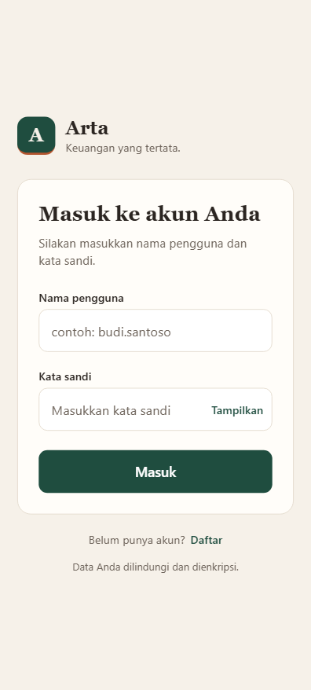
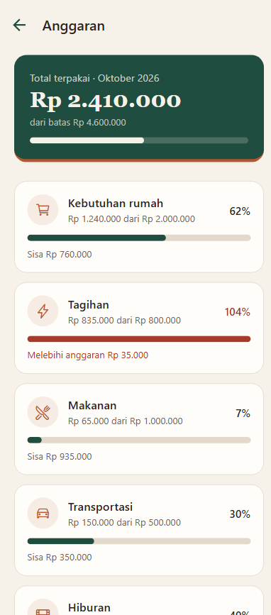
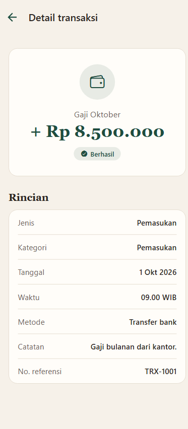
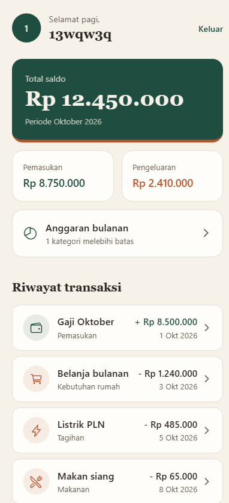

# Arta

## Identitas
Nama: Danny Satriani
NIM: 2602188276
Kelas: LA95

## Tema
Finance
Arta adalah prototipe aplikasi pencatatan keuangan pribadi. Pengguna dapat melihat saldo, riwayat transaksi, detail setiap transaksi, dan sisa anggaran per kategori dalam satu bulan.

Dibuat dengan Expo (React Native), NativeWind (Tailwind CSS) dan React Navi.

## Screenshots

## Cara Menjalankan
git clone <link https://github.com/dansatr/ARTAFINC>        
cd arta
npm install
npx expo start --web

## LINK
GDrive: https://drive.google.com/drive/folders/1tBE0Nj0j5_CcKmAgUo7KQmM0B_mA39cN?usp=sharing

## Penjelasan Konsep React Native

## Analisis Kebutuhan
