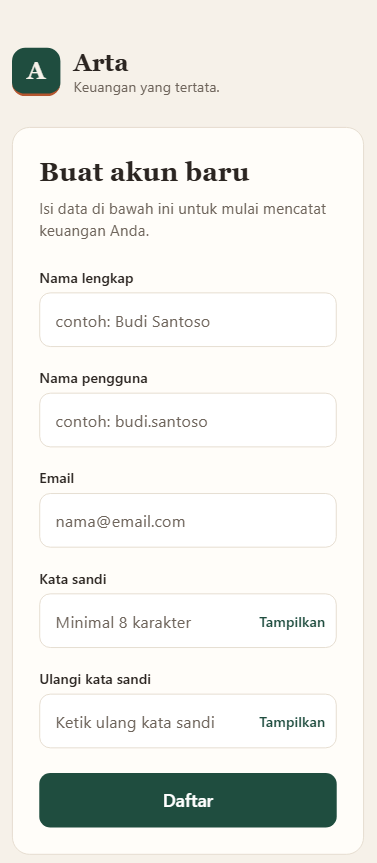

# Arta

## Identitas
- Nama: Danny Satriani
- NIM: 2602188276
- Kelas: LA95

## Tema
**Finance**

Arta adalah prototipe aplikasi pencatatan keuangan pribadi. Pengguna dapat melihat saldo, riwayat transaksi, detail setiap transaksi, dan sisa anggaran per kategori dalam satu bulan.

Dibuat dengan Expo (React Native), NativeWind (Tailwind CSS) dan React Navigation.

## Screenshots




## Cara Menjalankan
```bash
git clone https://github.com/dansatr/ARTAFINC
cd ARTAFINC
npm install
npx expo start --web
```

## Video Demo
Google Drive: https://drive.google.com/drive/folders/1tBE0Nj0j5_CcKmAgUo7KQmM0B_mA39cN?usp=sharing

## Soal 6 – Penjelasan Konsep React Native

React Native adalah framework dari Meta untuk membuat aplikasi mobile dengan JavaScript dan React. Berbeda dengan aplikasi hybrid lama yang menampilkan halaman web di dalam WebView, React Native merender komponen antarmuka asli (native) milik sistem operasi. Komponen `<View>` misalnya menjadi `UIView` di iOS dan `android.view.View` di Android.

Saat aplikasi berjalan, kode JavaScript dieksekusi oleh engine JavaScript, yang kini umumnya Hermes. Engine ini berkomunikasi dengan lapisan native melalui JSI (JavaScript Interface). Pada arsitektur baru, Fabric bertugas merender tampilan, sedangkan TurboModules mengakses fitur perangkat seperti kamera atau penyimpanan. Jadi pengembang cukup menulis logika dan tampilan dalam JavaScript, lalu React Native menerjemahkannya menjadi elemen native di setiap platform. Pada proyek Arta, Expo dipakai sebagai lapisan tambahan yang memudahkan konfigurasi, pengujian, dan proses build.

### Keunggulan untuk aplikasi hybrid

1. Kode yang sama bisa dijalankan di Android, iOS, bahkan web, dijalankan dengan `npx expo start --web`. Waktu dan biaya pengembangan jadi jauh lebih hemat.
2. Komponen yang dirender adalah elemen asli sistem operasi, bukan halaman web, sehingga animasi dan interaksi terasa lebih halus dibanding solusi berbasis WebView.
3. Perubahan kode langsung terlihat di layar tanpa harus mengompilasi ulang aplikasi, jadi proses perbaikan dan uji coba berjalan cepat.
4. Pengembang bisa memakai pustaka JavaScript yang sudah ada, seperti React Navigation untuk perpindahan layar atau NativeWind untuk styling menggunakan Tailwind.

### Komponen dan props

Komponen adalah bagian antarmuka yang bisa dipakai berulang kali. Props adalah data yang dikirim dari komponen induk ke komponen anak dan bersifat read-only. Di Arta, TransactionRow menerima props item dan onPress:

```jsx
export default function TransactionRow({ item, onPress }) {
  const category = categories[item.categoryId];
  const isIncome = item.amount > 0;
  // ...
}
```

HomeScreen memakai komponen ini untuk setiap transaksi di dalam FlatList:

```jsx
renderItem={({ item }) => (
  <TransactionRow
    item={item}
    onPress={() => navigation.navigate('Detail', { id: item.id })}
  />
)}
```

Di sini HomeScreen berperan sebagai komponen induk. Ia mengirim data transaksi melalui props item, serta fungsi yang dijalankan saat baris ditekan melalui props onPress. TransactionRow kemudian meneruskan sebagian data itu ke komponen anaknya sendiri:

```jsx
<CategoryIcon icon={category.icon} isIncome={isIncome} />
```

### State

State adalah data internal komponen yang bisa berubah. Setiap kali state berubah, komponen dirender ulang. Di LoginScreen, state menyimpan isi form, pesan error, dan status loading:

```jsx
const [username, setUsername] = useState('');
const [password, setPassword] = useState('');
const [errors, setErrors] = useState({});
const [formError, setFormError] = useState('');
const [loading, setLoading] = useState(false);
```

State tersebut diperbarui saat pengguna menekan tombol masuk:

```jsx
const newErrors = {};
if (!username.trim()) newErrors.username = 'Nama pengguna wajib diisi.';
if (!password) newErrors.password = 'Kata sandi wajib diisi.';

setErrors(newErrors);
setFormError('');
if (Object.keys(newErrors).length > 0) return;
```

Saat `setErrors` dipanggil, pesan error langsung muncul di bawah kolom input yang belum diisi. Hal yang sama terjadi saat `setLoading(true)` dipanggil: tombol masuk berubah ke status memuat.
  
### Navigasi
Arta memakai React Navigation dengan native stack. Semua layar didaftarkan di App.js:

```jsx
<Stack.Navigator initialRouteName="Login">
  <Stack.Screen name="Login" component={LoginScreen} options={{ headerShown: false }} />
  <Stack.Screen name="Register" component={RegisterScreen} options={{ headerShown: false }} />
  <Stack.Screen name="Home" component={HomeScreen} options={{ headerShown: false }} />
  <Stack.Screen name="Detail" component={DetailScreen} options={{ title: 'Detail transaksi' }} />
  <Stack.Screen name="Budget" component={BudgetScreen} options={{ title: 'Anggaran' }} />
</Stack.Navigator>
```

Data dikirim antarlayar melalui params. Misalnya, dari halaman detail sebuah pengeluaran, pengguna bisa membuka halaman anggaran sambil membawa kategori transaksi tersebut:

```jsx
// DetailScreen.js
onPress={() => navigation.navigate('Budget', { highlight: transaction.categoryId })}

// BudgetScreen.js
const highlight = route.params?.highlight;
```


Setelah login berhasil, aplikasi memakai `navigation.reset()` agar pengguna tidak bisa kembali ke halaman login dengan tombol back.

Keempat konsep ini saling terhubung dalam Arta. Komponen menyusun tampilan, props mengalirkan data ke bawah, state menangani data yang berubah seperti input form, dan navigasi menghubungkan alur dari login sampai detail transaksi dan anggaran.


## Soal 8 – Analisis Kebutuhan

### Masalah

- Banyak orang tidak tahu ke mana uangnya habis setiap bulan.
- Pencatatan manual, baik di buku, catatan HP, maupun spreadsheet, terasa merepotkan dan jarang dibuka lagi.
- Pengeluaran yang berlebihan sering baru disadari ketika saldo sudah menipis.

### Target Pengguna

- Mahasiswa dan pekerja muda (±18–30 tahun) yang mulai mengatur keuangannya sendiri.
- Terbiasa memakai HP dan membutuhkan tampilan yang cepat dibaca, bukan aplikasi akuntansi yang rumit.

### Kebutuhan Pengguna

1. Masuk dan mendaftar akun dengan mudah.
2. Melihat total saldo, pemasukan, dan pengeluaran secara sekilas.
3. Melihat riwayat transaksi beserta kategorinya.
4. Melihat informasi lengkap dari satu transaksi.
5. Mengetahui sisa anggaran per kategori dan kapan anggaran terlampaui.
6. Memakai aplikasi di HP maupun di laptop.

### Pemetaan Kebutuhan ke Layar dan Komponen

| No | Kebutuhan | Layar | Komponen |
|----|-----------|-------|----------|
| 1 | Masuk dan mendaftar akun | `LoginScreen`, `RegisterScreen` | `AuthLayout`, `BrandHeader`, `TextField`, `PrimaryButton` |
| 2 | Melihat saldo, pemasukan, dan pengeluaran | `HomeScreen` | `SummaryTile` |
| 3 | Melihat riwayat transaksi | `HomeScreen` | `FlatList`, `TransactionRow`, `CategoryIcon` |
| 4 | Melihat detail transaksi | `DetailScreen` | `CategoryIcon`, `InfoRow`, `PrimaryButton` |
| 5 | Memantau anggaran per kategori | `BudgetScreen` | `ProgressBar`, `CategoryIcon` |
| 6 | Dipakai di HP dan laptop | Semua layar | React Native + `react-native-web`, lebar maksimum konten (`max-w-[560px]`) |

### Alasan Keputusan Desain

- Warna hangat (krem, hijau tua, terakota). Memberi kesan tenang dan tepercaya untuk urusan uang, sekaligus membedakan Arta dari aplikasi bank yang umumnya biru-putih.
- Hijau untuk pemasukan, terakota untuk pengeluaran, merah untuk anggaran yang terlampaui. Pengguna bisa menangkap kondisi keuangannya dari warna sebelum membaca angka.
- Ikon per kategori. Membuat transaksi lebih cepat dikenali di dalam daftar.
- Kartu anggaran dengan progress bar. Lebih mudah dipahami dibandingkan tabel berisi angka.
- Validasi langsung di bawah kolom input. Pengguna tahu persis bagian mana yang perlu diperbaiki.
- Komponen reusable dan data di berkas terpisah. Tampilan tetap konsisten, dan sumber data mudah diganti ketika backend sudah tersedia.

### Rencana Pengembangan

- Menghubungkan login dan register ke backend dengan autentikasi sungguhan.
- Menyimpan data di database sebagai pengganti `sampleData.js`.
- Menambahkan fitur tambah, ubah, dan hapus transaksi.
- Memungkinkan pengguna mengatur batas anggaran sendiri untuk setiap kategori.
- Menampilkan grafik pengeluaran bulanan.
- Mengirim pengingat saat anggaran hampir habis.